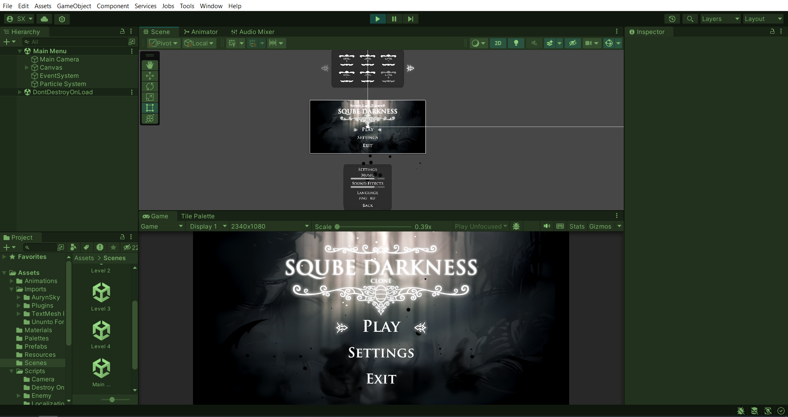
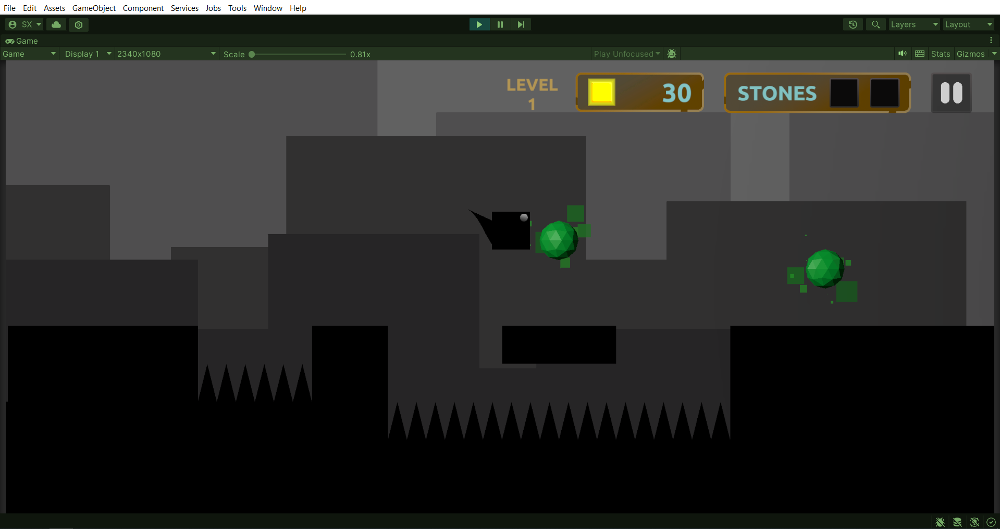
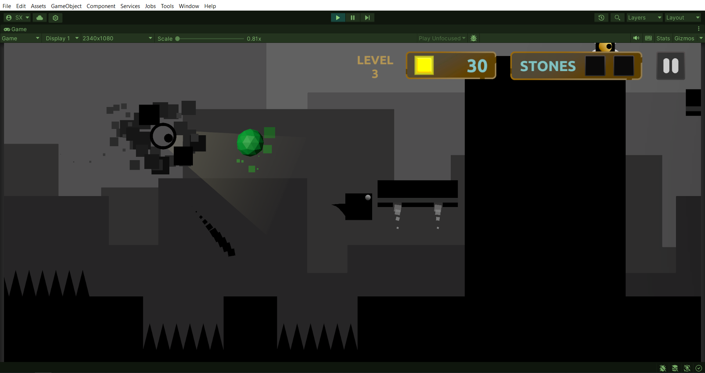
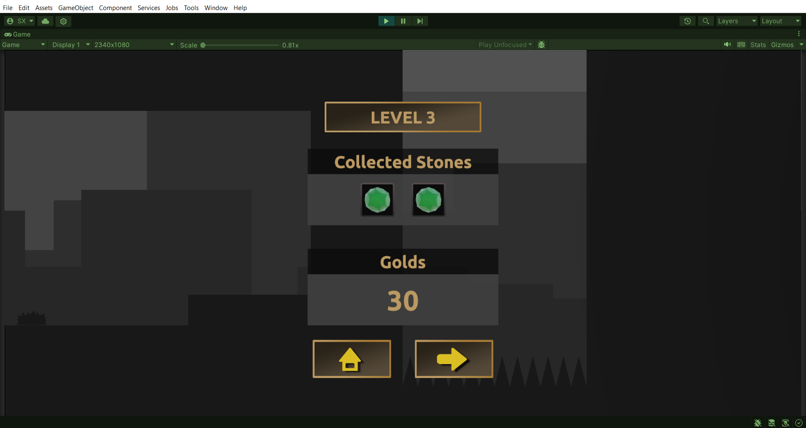
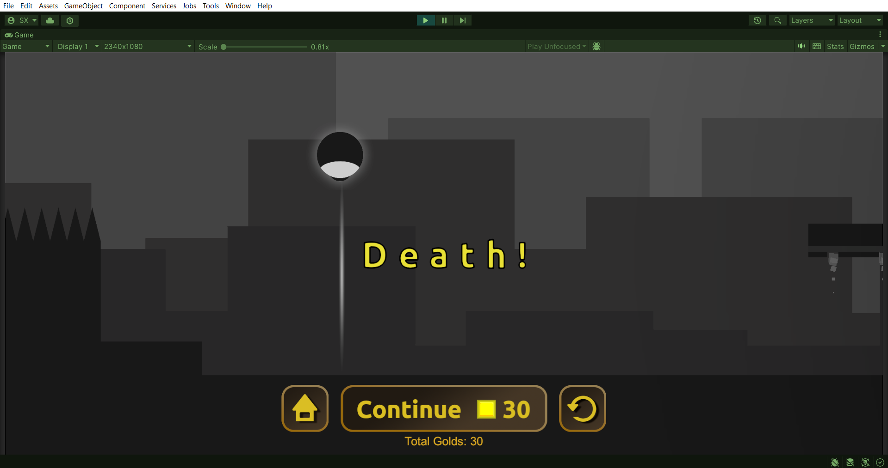

      

   
   
   

## Video

[Watch a gameplay demo](https://youtu.be/Q6g0qQRrDDY)

## About

A clone of the game Sqube Darkness/Escape. Absolutely all of the game's mechanics have been implemented. The menu is styled after Hollow Knight.

## Distribute

- [Telegram](https://t.me/ghgkgkrjkfjfjkxeddkkw)

## Screenshots

      
      
      
      
      

